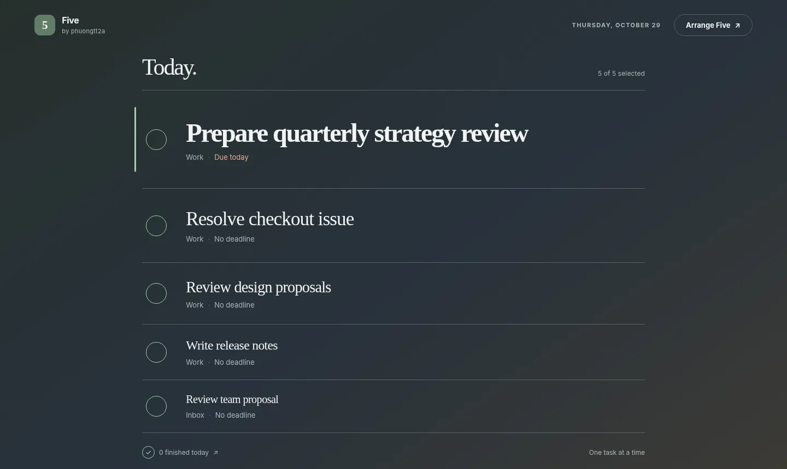
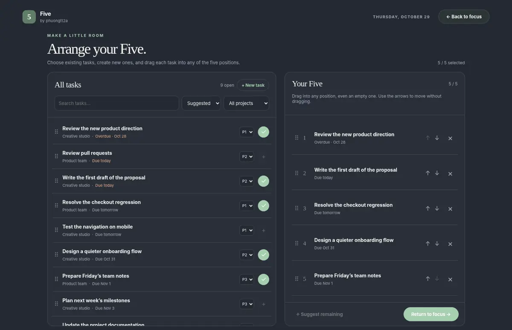

# Five

**Focus on what matters. Five tasks at a time.**  
An independent, zen-inspired plugin for **[Super Productivity](https://app.super-productivity.com/)** by **[phuongtt2a](https://github.com/phuongtt2a)**.

[](https://super-productivity.com/) [](LICENSE)

**Super Productivity** is an open-source task manager and time-tracking app. Try it at **[app.super-productivity.com](https://app.super-productivity.com/)**. **Five** adds a quiet, dedicated view showing only five tasks you want to focus on now, in the order you choose. It's a companion to Super Productivity—not a replacement for its projects, backlog, or time tracking.



## Why only five?

A backlog answers *“What could I do?”* Five helps answer *“What will I focus on next?”*

Choosing a small number of tasks can make your day feel clearer: fewer competing options, a visible priority order, and less time repeatedly deciding where to begin. The first task gets the largest type because it deserves the most attention. **Five is a deliberate design limit, not a scientifically proven optimal number.** It is meant to encourage intentional planning while leaving room to change the plan.

## What you can do

- **See your Five at a glance.** The focus screen has five ranked lines, no task library, no cards, no repeated add buttons, and no vertical scrolling. Task #1 is largest; titles gradually decrease in size through #5.
- **Arrange Five.** Open a separate planning screen to find tasks in your Super Productivity projects, search, sort by due date or plugin priority, and assign or drag them into any of five positions.
- **Keep empty slots where you want them.** You can put your first task directly into position #4 or #5. Moving a task swaps it with another task or moves it into an empty slot; it doesn't automatically compact everything to the top. Use the arrow controls if dragging is inconvenient.
- **Create tasks without leaving Five.** Use **New task** in Arrange Five; tasks are created in Super Productivity, not in a separate private list.
- **Make room as you finish.** Mark a task complete and its slot becomes available. You can select another task, even if you've already completed five tasks that day.
- **Keep today's plan.** Your daily positions and plugin-defined priorities are saved using Super Productivity's plugin synced-data API.



## Install

1. Open the **[latest GitHub Release](https://github.com/phuongtt2a/super-productivity-five/releases/latest)** and download **`five-super-productivity.zip`** from **Assets**.
2. Open **[Super Productivity](https://app.super-productivity.com/)**.
3. Go to **Settings → Plugins**.
4. Choose **Choose Plugin File** (or the equivalent plugin import option) and select the downloaded ZIP.
5. Open **Five** from the Super Productivity plugin menu. You can now choose or create tasks in **Arrange Five**.

The ZIP is ready to import as-is. **Do not unzip it before installing.** A single plugin ZIP contains precisely four files at its root:

```text
five-super-productivity.zip
├── manifest.json
├── plugin.js
├── index.html
└── icon.svg
```

No separate server, login, hosting, or Node.js build is required to run Five inside Super Productivity. If you're updating from an older local build of the same plugin, import the new ZIP (some host versions may require removing the previous plugin first).

## Using Five

1. Open **Five** to see five visible positions.
2. Select **Arrange Five**. Search or filter your tasks, or choose **New task**.
3. Use `+` to fill the first available position, or **drag from the task library directly onto a specific slot**. Drag within the selected list to exchange positions; the ↑ and ↓ controls provide a keyboard/touch-friendly alternative.
4. Select **Return to focus** and begin at whichever position is most important.
5. Click the circular control next to a task to complete it in Super Productivity. Its position opens up for another task.

The five slots represent **simultaneous focus**, not a daily completion quota.

## Notes and limitations

- **Priority** is a per-task setting stored by this plugin. Super Productivity's documented plugin Task interface has `dueDay` and `dueWithTime`, but no native `priority` property. Changing priority in Five does not modify a native Super Productivity priority field.
- **Completed tasks** are marked complete in Super Productivity using the official task update API. Removing a task from Five does **not** delete or complete the underlying task.
- The **focus view does not scroll**. Very long titles are limited to two display lines so all five positions remain visible; open the task to see its full title and details.
- **Drag-and-drop** uses HTML drag events. For touch devices, use the position arrows in Arrange Five instead. Sorting affects the *task library*, not the intentional order of your Five.
- **Daily selection** is stored separately by local date. Restarting or reopening the plugin preserves today's slots; a new day starts with empty slots. The exact synchronization behavior depends on the user's Super Productivity sync configuration.
- **Independently maintained:** Five is not an official Super Productivity feature or an affiliated product.

## Develop and package

The source is intentionally small and framework-free:

```text
plugin/                 # the four runtime files in the installed ZIP
scripts/package.py      # reproducible ZIP builder, Python 3.10+
tests/test_package.py   # manifest and package validation
.github/workflows/      # checks and tagged GitHub releases
docs/screenshots/       # example UI screenshots
```

Run these commands from the repository root:

```bash
python -m unittest discover -s tests -v
python scripts/package.py
```

The second command writes **`dist/five-super-productivity.zip`**. Opening `plugin/index.html` in a browser outside Super Productivity shows **local demo data** for visual checks; install the ZIP in Super Productivity to test its actual task API and synced storage.

For implementation details, see [Development](docs/DEVELOPMENT.md), for first-time publishing see [Publishing](docs/PUBLISHING.md), and for changes see the [Changelog](CHANGELOG.md).

## Publish a release (maintainers)

The first release is created by the initial publishing commit (`release: publish Five v3.1.0`). For subsequent releases, bump the manifest version and push a matching version tag. The workflow validates, builds, and attaches the installable ZIP:

```bash
git tag v3.1.0
git push origin v3.1.0
```

Watch **Actions → Publish plugin release** and then verify **Releases → Assets** contains `five-super-productivity.zip`. Version tags must match the manifest version.

## License

[MIT](LICENSE) © 2026 **phuongtt2a**. Super Productivity belongs to its respective maintainers.
